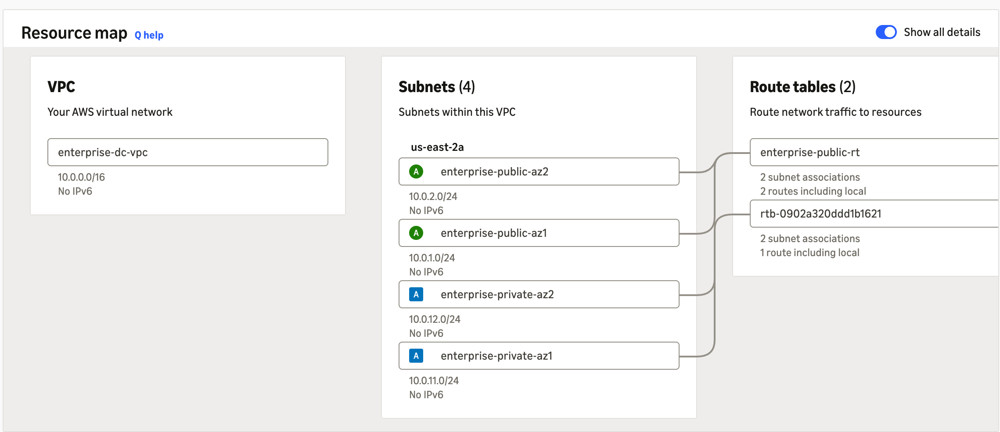

# AWS Virtual Data Center

This repository documents a two-tier Amazon VPC built across two Availability Zones.

## Network plan

- VPC: `10.0.0.0/16`.
- Public subnets: `10.0.1.0/24` and `10.0.2.0/24`.
- Private application subnets: `10.0.11.0/24` and `10.0.12.0/24`.

## Routing

The public subnets use `enterprise-public-rt`, which sends `0.0.0.0/0` to `enterprise-dc-igw`. The private subnets use the main route table and keep local-only routing.

## Security boundaries

`enterprise-web-sg` accepts TCP port `80` from `0.0.0.0/0`. `enterprise-app-sg` accepts TCP port `8080` only from `enterprise-web-sg`.

## Infrastructure as code

The Terraform files reproduce the core network design. Automated checks validate formatting and configuration without applying resources.
